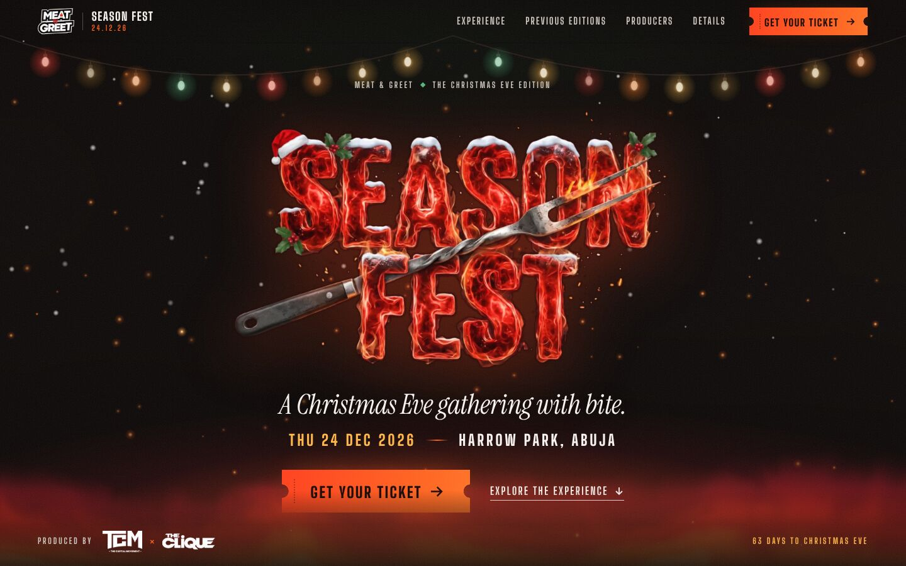

# SEASON FEST 2026: landing page

The Christmas Eve edition of **MEAT & GREET**: Thursday 24 December 2026, Harrow Park, Abuja.
Produced by **The Capital Movement (TCM) × The Clique**.

A single-page, production-ready event site with a cinematic, scroll-driven opening, the supplied
artwork and real MEAT & GREET photography, and one ticket path wired through a single config value.



---

## Quick start

Requires **Node.js 22.12 or newer**.

```bash
cd season-fest
npm install
npm run dev        # http://localhost:4321 with hot reload
npm run build      # static site → dist/
npm run preview    # serve dist/ locally
npm run check      # TypeScript + Astro diagnostics
npm run qa         # browser QA across 5 viewports (needs `npm run preview` running)
npm run og         # re-render the social share image (public/og/season-fest-og.jpg)
```

`npm run qa` and `npm run og` use Playwright. If it isn't installed, run
`npm i -D playwright && npx playwright install chromium`.

---

## Change the ticket link (the most important setting)

Open **`src/config/event.ts`** and set:

```ts
export const TICKET_URL: string | null = 'https://your-official-ticket-page';
```

Or, without touching code, set the environment variable **`PUBLIC_TICKET_URL`** in your hosting
dashboard and redeploy. The environment variable wins when both are set.

When a URL is present, the next build automatically:

| What                                                | Before (`null`)                                                   | After (URL set)                                   |
| --------------------------------------------------- | ----------------------------------------------------------------- | ------------------------------------------------- |
| All 7 “Get your ticket” buttons                     | Open a “Tickets drop soon” dialog (no JS: jump to `#tickets`)     | Open the official ticket page in a new tab        |
| Ticket dialog                                       | Rendered                                                          | Removed from the page                             |
| Details → Tickets row                               | “Official link coming soon”                                       | “On sale now”                                     |
| FAQ                                                 | “When do tickets go on sale?”                                     | “Where do I buy tickets?”                         |
| Event structured data (JSON-LD)                     | No offer                                                          | `Offer` with the ticket URL                       |

Every CTA is rendered by `src/components/TicketCTA.astro`, so label and destination can never drift
apart. Clicks fire a `seasonfest:ticket-click` browser event and push `ticket_cta_click` to
`window.dataLayer` when Google Tag Manager is present, ready for analytics.

---

## Update event details, artists and sponsors

Everything editable lives in **`src/config/event.ts`**. Unconfirmed values are `null` or empty, and
the page simply omits them. Fill a value in and it appears on the next build.

| To…                              | Edit                                                                                                                                                                  |
| -------------------------------- | --------------------------------------------------------------------------------------------------------------------------------------------------------------------- |
| Add start/end times              | `EVENT.startTime` / `EVENT.endTime` (e.g. `'16:00'`). Shown in Details and added to the Event schema with the +01:00 (WAT) offset.                                    |
| Add age limit or dress code      | `EVENT.ageRestriction`, `EVENT.dressCode`. A new row appears in Details.                                                                                             |
| Announce artists                 | Add entries to `LINEUP`, e.g. `{ name: 'Artist', role: 'Headliner' }`. “The Sound” chapter shows the lineup (headliner first), the FAQ and schema update, and “Lineup to be announced” disappears. |
| Add sponsors / media partners    | Put the logo in `public/partners/` (SVG or PNG), then add `{ name, logo: '/partners/file.svg', url?, tier? }` to `SPONSORS` or `MEDIA_PARTNERS`. They replace the “Partners will be announced” note. |
| Add The Clique’s socials         | Append to `SOCIALS` (`network: 'instagram' \| 'x' \| 'tiktok' \| 'facebook' \| 'youtube'`).                                                                          |
| Change venue address / map pin   | `VENUE`. Replace `mapsUrl` / `mapsEmbedUrl` with an official pin when the venue publishes one.                                                                         |
| Hide the guest quotes            | `SHOW_TIMELINE_QUOTES = false`.                                                                                                                                       |
| Change SEO title/description     | `SEO`. Run `npm run og` if the share card text should change too.                                                                                                     |

Images and their alt text live in **`src/config/media.ts`**. Replace a file in `src/assets/…`
with one of the same name, or point an entry at a new import. Astro generates AVIF/WebP at
responsive sizes at build time.

---

## Project structure

```
season-fest/
├── astro.config.mjs          # SITE_URL / BASE_PATH env, inline CSS
├── public/                   # favicons, manifest, robots.txt, og/season-fest-og.jpg
├── scripts/
│   ├── qa.mjs                # Playwright QA: errors, overflow, CLS, modal, a11y, screenshots
│   └── render-og.mjs         # renders the 1200×630 share image from the real assets
├── docs/screenshots/         # desktop, tablet and mobile captures of the finished page
└── src/
    ├── config/
    │   ├── event.ts          # ★ TICKET_URL, event facts, socials, lineup, sponsors, FAQ, SEO
    │   └── media.ts          # every image + alt text + source notes
    ├── assets/
    │   ├── brand/            # SEASON FEST, MEAT & GREET, TCM, The Clique marks
    │   ├── photos/           # 24 real MEAT & GREET photos
    │   └── food/             # grill / steak photography from the deck
    ├── layouts/Base.astro    # <head>: meta, Open Graph, Event JSON-LD, motion bootstrap
    ├── pages/
    │   ├── index.astro       # page composition
    │   └── season-fest-2026.ics.ts   # all-day calendar file, generated from config
    ├── components/
    │   ├── Header.astro              # nav + native popover mobile menu
    │   ├── HeroSection.astro         # hero + “Into the heat” pinned stage
    │   ├── IntroSection.astro        # “Christmas Eve. Turned all the way up.”
    │   ├── ExperienceSection.astro   # The Grill / The Sound / The People / The Festival
    │   ├── FestivalGallery.astro     # previous editions + guest quotes
    │   ├── PropositionSection.astro  # “Your Christmas Eve plans just changed.” + ticket stub
    │   ├── ProducerSection.astro     # TCM × The Clique + partners slot
    │   ├── EventDetails.astro        # facts, #tickets, map, calendar, FAQ
    │   ├── FinalCTA.astro            # “Save room for the heat.”
    │   ├── Footer.astro
    │   ├── TicketCTA.astro           # ★ the only ticket button
    │   ├── TicketModal.astro         # “Tickets drop soon” dialog
    │   ├── MobileTicketBar.astro     # sticky phone CTA after the hero
    │   ├── FestoonLights.astro       # Christmas string lights (SVG, build-time)
    │   └── SocialIcon.astro
    ├── scripts/
    │   ├── main.ts           # CTA routing, dialog, header, mobile bar, countdown, map facade
    │   ├── motion.ts         # GSAP + ScrollTrigger + SplitText choreography (motion only)
    │   └── fx/
    │       ├── flames.ts     # WebGL fire/smoke shader (raw WebGL, one quad)
    │       └── particles.ts  # snow → ember particle field (Canvas 2D)
    └── styles/global.css     # design tokens, base, reveal system
```

---

## Design system

**Idea:** Christmas Eve meets the fire. The page opens on a cold Christmas night under festoon lights,
and as you scroll **into the heat**, falling snow crosses a rising melt line and ignites into embers.
The fire climbs and the type fills white-hot. That snow-to-ember field is the signature, and it ties to
Abuja's real December: *Harmattan nights run cold.*

| Token        | Value     | Use                                      |
| ------------ | --------- | ---------------------------------------- |
| Obsidian     | `#0b0807` | base background                          |
| Burgundy     | `#4a0c11` | depth, glows                             |
| Flame        | `#e8261c` | fire gradient                            |
| Ember        | `#ff5e1a` | CTAs, accents                            |
| Gold         | `#ffb547` | dates, highlights                        |
| Silver       | `#cfc8c1` | metallic accents (the fork), the ×       |
| Smoke        | `#a1968f` | secondary text (AA on obsidian)          |
| Holly        | `#2e7d4f` | sparing Christmas accent                 |
| Snow         | `#f7f2ec` | primary text                             |

- **Type:** Big Shoulders Display (condensed poster type), Instrument Sans (body), Instrument Serif
  italic (rare editorial accents). All self-hosted via Fontsource, with the two critical files preloaded.
- **Recurring device:** ticket-stub notches on every CTA, echoed by the stub in the proposition section.

### Motion principles

- One pinned moment, the opening stage. Everything else scrolls natively. There is no scroll-jacking
  and no smooth-scroll library.
- One-shot reveals use IntersectionObserver + CSS transitions. ScrollTrigger is used only for scrubbed
  motion (the stage, parallax, gallery drift).
- Animations use only transforms, opacity and clip-path, so there's no layout shift (CLS measured at 0).
- Fire and particles render at reduced resolution, pause offscreen and in hidden tabs, and are skipped
  for Save-Data and very low-memory devices.
- **`prefers-reduced-motion`:** no pinning, particles, shader, parallax or reveals. The opening stage
  becomes a normal static hero followed by the “Into the heat” block.
- **No JavaScript:** the full page is readable; the menu works (native `popover`); ticket buttons
  land on the `#tickets` details block. Nothing is hidden by default; motion is opt-in via a class
  set in `<head>`, with a 4.5s failsafe that restores the static layout if the motion bundle fails.

---

## Test results (22 October 2026, production build)

**Build:** `npm run build` completes with no errors or warnings. `npm run check` gives 0 errors,
0 warnings and 0 hints.

**Lighthouse 13.5** (headless Chromium, software-rendered WebGL, local preview server):

| Profile | Performance | Accessibility | Best practices | SEO | LCP   | TBT       | CLS |
| ------- | ----------- | ------------- | -------------- | --- | ----- | --------- | --- |
| Desktop | 100         | 100           | 100            | 100 | 0.7 s | 0 ms      | 0   |
| Mobile  | 89–92       | 100           | 100            | 100 | 3.2–3.3 s | 80–240 ms | 0 |

Mobile was measured over three runs with simulated slow 4G and 4× CPU throttling. The headless run
renders WebGL in software, so the live flame shader costs more there than on a real phone's GPU.
Page weight on first load is about 330 KB.

**Browser QA** (`npm run qa`) at 1440×900, 1280×720, 834×1194, 390×844 and 360×760:

- No console or page errors, and no horizontal overflow at any size.
- CLS of 0 through a full scroll at every viewport.
- The ticket dialog opens from the keyboard, closes on Esc and returns focus to the button.
- The mobile ticket bar appears after the hero and hides near the details and the end of the page.
- Reduced motion leaves no content hidden.
- The no-JS hero CTA points to `#tickets`.
- The hero, including the producer credit, fits one screen down to 360×760 and 1280×720.

A deploy-style build with `SITE_URL` + `BASE_PATH=/season-fest/` + `PUBLIC_TICKET_URL` was also
verified. It produced the canonical URL, absolute Open Graph/JSON-LD image URLs, every asset under
the base path, all 7 CTAs live, the dialog removed and the schema `Offer` present.

Screenshots: [`docs/screenshots/`](docs/screenshots/).

---

## Deploy

The output is a static folder (`dist/`), so it works on any static host. Set these environment
variables where relevant:

| Variable            | Purpose                                                                 |
| ------------------- | ----------------------------------------------------------------------- |
| `PUBLIC_TICKET_URL` | Official ticket link (optional; overrides `TICKET_URL`)                 |
| `SITE_URL`          | Public origin, e.g. `https://seasonfest.ng`. Enables canonical and absolute share-image URLs. **Set this for production**, as Facebook/WhatsApp previews need absolute image URLs. |
| `BASE_PATH`         | Sub-path, e.g. `/season-fest/`, if served inside another site           |

**Vercel:** import the repo, set *Root Directory* to `season-fest`, framework preset **Astro**,
add the env vars and deploy.

**Netlify:** base directory `season-fest`, build command `npm run build`, publish directory
`season-fest/dist`, Node version 22.

**Cloudflare Pages:** root `season-fest`, build `npm run build`, output `dist`, and set
`NODE_VERSION=22`.

**Inside thecapitalmovement.com** (the static site in this repo's root): build with
`SITE_URL=https://thecapitalmovement.com BASE_PATH=/season-fest/ npm run build` and copy
`season-fest/dist/` into a `season-fest/` folder at the site root.

Changing a ticket link or any config value only needs a rebuild/redeploy (most hosts do this
automatically on push).

---

## Asset sources and licensing

| Asset | Source | Notes |
| ----- | ------ | ----- |
| SEASON FEST logo | Supplied artwork (`season fest_(1)`) | Transparent padding trimmed only; the artwork itself is unaltered. |
| MEAT & GREET logo | Cut from deck p.1 (logo is baked into the slide) | Background removed along the logo's own white keyline. Replace with an original vector file if one exists. |
| TCM and The Clique logos | Deck p.12 / supplied PNGs | The Clique converted from white-on-black to white-on-transparent. |
| 20 event photos | Deck p.10–11 “Previous edition” galleries | Extracted from the PDF at native resolution (about 390–470 px wide), so they are shown at modest sizes. **Higher-resolution originals from the photographer would sharpen the gallery noticeably.** Photographer watermarks are kept. |
| Audience photo | Deck p.4 (2000 px) | Used for the large gallery feature. |
| 3 event photos | Already published on thecapitalmovement.com (`assets/events/meat-and-greet-*.jpg`) | Labelled there as MEAT & GREET. |
| Grill and steak photos | Backgrounds of deck p.2–3 | **Licence status unknown.** They look like stock photography; confirm the deck's licence covers web use, or swap in licensed images (same file names in `src/assets/food/`). |
| Guest quotes | Public posts reproduced in deck p.6–9 (March 2023) | Verbatim, handles removed; toggle with `SHOW_TIMELINE_QUOTES`. |
| Fonts | Big Shoulders Display, Instrument Sans, Instrument Serif | SIL Open Font License. |
| GSAP 3.15 (incl. ScrollTrigger, SplitText) | gsap.com | Free “Standard no-charge” licence. |

No AI-generated imagery is used, and no attendance numbers, testimonials, artists, prices, times or
sponsors were invented.

---

## Awaiting confirmation

These are currently `null` or empty and hidden from the page:

- **Official ticket URL** (`TICKET_URL`)
- **Official domain** (`SITE_URL`): needed for canonical URL and reliable share previews
- **Start / end time**, age restriction, dress code
- **Lineup** (artists, DJs, host)
- **Sponsors and media partners**
- **The Clique's** website and social handles
- **Venue pin:** the address (*off Ahmadu Bello Way, behind Abia House, Central Business District*)
  comes from public Abuja directories, and the map resolves by venue name, so no coordinates were
  guessed. Confirm with the venue before printing anything.
- **Food photography licence** (see above)
- Contact: `contact@thecapitalmovement.com` (published on TCM's site) is used for partnership
  enquiries. Change `CONTACT.email` if Season Fest should use a different inbox.
