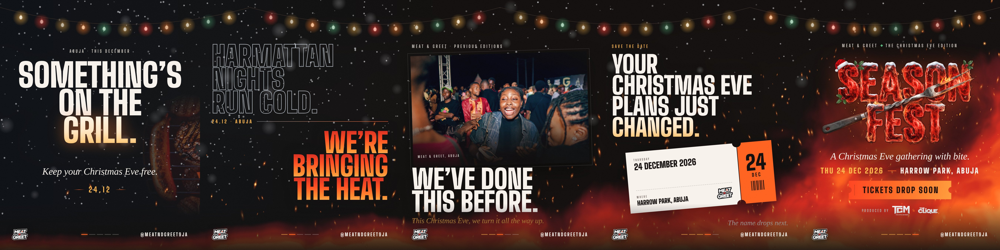

# SEASON FEST teaser campaign: “Cold to Fire”

Five 4:5 flyers (2160×2700, Instagram feed and carousel ready) that start the promotion before
tickets, lineup and times are announced. Every line uses confirmed facts only: date, venue,
MEAT & GREET, TCM × The Clique, @meatndgreet9ja.



## The idea

The website's signature, snow turning into embers, is told across five frames. The night warms
from a cold Harmattan sky (01) to full fire behind the logo reveal (05). The festoon lights hang
across the slide edges, so posted as a carousel the five flyers join into one continuous scene.
Posted one by one, each still stands alone, and the progress bar in the footer shows where it
sits in the sequence.

| # | File | Job | Withholds |
| - | ---- | --- | --------- |
| 01 | `season-fest-teaser-01-something-on-the-grill.jpg` | Mystery hook: “Something’s on the grill. Keep your Christmas Eve free. 24.12” | Event name |
| 02 | `season-fest-teaser-02-bringing-the-heat.jpg` | Abuja-specific promise: “Harmattan nights run cold. We’re bringing the heat.” | Event name |
| 03 | `season-fest-teaser-03-done-this-before.jpg` | Proof with a real previous-edition photo: “We’ve done this before.” | Event name |
| 04 | `season-fest-teaser-04-save-the-date.jpg` | Save the date: ticket stub with date + venue. “The name drops next.” | Event name |
| 05 | `season-fest-teaser-05-season-fest-reveal.jpg` | Reveal: SEASON FEST logo, date, venue, producers, “Tickets drop soon” | Nothing |

## Posting plan

Pick one of these:

- **Drip (recommended):** post one flyer every two days, so 01 → 05 runs over about 10 days, ending on
  the reveal. Use 04's line “The name drops next” the day before 05.
- **Carousel:** post all five as one carousel in order. Swiping reveals the continuous scene.

Re-share each post to Stories and WhatsApp Status. The 4:5 frame sits with a little space top and
bottom there.

## Captions

**01:** Something’s on the grill, Abuja. 🔥 Keep your Christmas Eve free. 24.12.
Follow @meatndgreet9ja so you don’t miss what drops next.
`#MeatAndGreet #AbujaEvents #AbujaTwitterCommunity #ChristmasEveAbuja`

**02:** Harmattan nights run cold. We’re bringing the heat. 24.12 · Abuja.
`#MeatAndGreet #AbujaEvents #ChristmasEveAbuja`

**03:** We’ve done this before, Abuja. This Christmas Eve, we turn it all the way up.
(Real nights from previous MEAT & GREET editions.)
`#MeatAndGreet #AbujaEvents #AbujaTwitterCommunity`

**04:** Your Christmas Eve plans just changed. Thursday 24 December 2026 · Harrow Park, Abuja.
Save the date. The name drops next. 👀
`#MeatAndGreet #SaveTheDate #ChristmasEveAbuja`

**05:** SEASON FEST. The Christmas Eve edition of MEAT & GREET. 🎄🔥
A Christmas Eve gathering with bite. Thursday 24 December 2026 · Harrow Park, Abuja.
Produced by TCM × The Clique. Tickets drop soon. Turn on post notifications for @meatndgreet9ja.
`#SeasonFest #MeatAndGreet #AbujaEvents #ChristmasEveAbuja`

## Editing and re-rendering

All five flyers are generated from one file, `render-teasers.mjs`, using the real fonts,
supplied logos, real MEAT & GREET photography and the website's own flame shader. To change copy
or layout, edit that file and run:

```bash
npm run teasers   # → campaign/teasers/*.jpg + carousel-preview.jpg (needs Playwright)
```

Ideas for the next wave once details are confirmed: a lineup announcement in the same system, a
“tickets are live” flyer (swap 05's “Tickets drop soon” stub for the link), and 9:16 Story versions.
